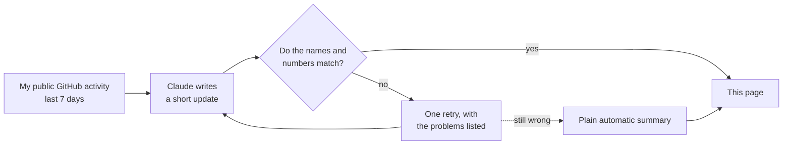

<!-- Generated by scripts/build.py from profile.toml. Edit those, not this file. -->

<picture>
  <source media="(prefers-color-scheme: dark)" srcset="assets/hero-dark.svg">
  
</picture>

<p align="center">
<a href="https://www.linkedin.com/in/math-191231"></a> <a href="mailto:matheshwara13@gmail.com"></a> <a href="https://ieeexplore.ieee.org/document/9569897"></a> <a href="https://github.com/msenthi7/Research-and-Publications/tree/main/Patent"></a> <a href="https://msenthi7.github.io/msenthi7/"></a> <a href="#this-week"></a>
</p>

I'm a machine learning engineer, working mostly on healthcare and finance. I started out in electronics (an IEEE paper and a patent), then moved into machine learning and data science at the University of Maryland, where I also worked as a data scientist at the Counseling Center Research Unit. Recently I built **ClinIQ**, a patient-triage assistant for small clinics, at the Anthropic Hackathon.

<b><a href="https://msenthi7.github.io/msenthi7/">▶ Try the interactive version of this page</a></b>, where you can remix the intro and
search my work.

## About me

| **Name** | **Matheshwara Annamalai Senthilkumar** · `msenthi7` |
|:--|:--|
| **What I do** | Chatbots that answer from real documents, AI that uses tools, and machine learning for finance and healthcare |
| **Background** | Electronics: an [IEEE paper](https://ieeexplore.ieee.org/document/9569897) on 160 GHz amplifiers for 5G and satellites, and a [patent](https://github.com/msenthi7/Research-and-Publications/tree/main/Patent) for a child-safety wearable |
| **Studied** | Machine learning & data science, University of Maryland |
| **Worked** | Data Scientist, [UMD Counseling Center Research Unit](https://counseling.umd.edu/about-us/research-unit): a campus-wide survey on food access and student well-being, presented to UMD's Vice President of Student Affairs and at the [Maryland Student Affairs Conference](https://msac.umd.edu/conference-program/sessions) |
| **Highlights** | [ClinIQ](https://github.com/msenthi7/ClaudeHack) at the Anthropic Hackathon · APA 2026 poster on ChatGPT vs human researchers · EV driving range predicted with R² = 0.918 |
| **Known bug** | Overfits to hard problems. |
| **Open to** | ML / AI engineering roles and research collaborations |

## Projects

<table>
<tr>
<td width="50%" valign="top">
<b><a href="https://github.com/msenthi7/ClaudeHack">ClinIQ</a></b> <sub>· Healthcare AI</sub><br>
<i>Helps doctors at under-resourced clinics decide which patients to see first.</i><br>
<sub><b>How</b> Ranks patients with a simple, transparent point score. A local AI model then writes a summary for the doctor and a plain-language one for the patient, answering only from a medical encyclopedia and FDA drug labels. A three-step check flags unsafe prescriptions.</sub><br>
<sub><b>Result</b> Built at the Anthropic Hackathon (Health &amp; Wellbeing track). If the medical knowledge base is missing, the AI features turn off.</sub><br>
<sub><b>Built with</b> Python · Llama 3.1 (Ollama) · ChromaDB · Streamlit · Pydantic</sub>
</td>
<td width="50%" valign="top">
<b><a href="https://github.com/msenthi7/Quant_LLM">Sentimental Liquidity</a></b> <sub>· Finance</sub><br>
<i>Uses the tone of Federal Reserve statements to improve a bank&#x27;s interest-rate risk model.</i><br>
<sub><b>How</b> Claude rates each Fed statement from dovish to hawkish (1–10). That one number nudges a standard interest-rate model, which simulates 1,000 possible futures; a second model estimates how many depositors would leave in each.</sub><br>
<sub><b>Result</b> A Value-at-Risk report for a simulated $10B bank. The AI provides one score, and everything else is standard math.</sub><br>
<sub><b>Built with</b> Python · Claude API · NumPy · SciPy · scikit-learn</sub>
</td>
</tr>
<tr>
<td width="50%" valign="top">
<b><a href="https://github.com/msenthi7/TravelGenie">TravelGenie</a></b> <sub>· Automation</sub><br>
<i>Plans a whole trip from one request.</i><br>
<sub><b>How</b> Claude coordinates seven small tools (flights, hotels, events, maps, weather, currency, traffic), with a web app and a Slack bot on top.</sub><br>
<sub><b>Result</b> One request becomes a day-by-day itinerary with a budget. Team project.</sub><br>
<sub><b>Built with</b> Python · Claude API · MCP · Streamlit · Slack</sub>
</td>
<td width="50%" valign="top">
<b><a href="https://github.com/msenthi7/RAG_using_Mistral_ChromaDB">Private Medical Chatbot</a></b> <sub>· Healthcare AI</sub><br>
<i>A medical Q&amp;A chatbot that keeps patient data on your own computer.</i><br>
<sub><b>How</b> An open-source AI model runs on the local machine. It searches medical PDFs before answering, declines off-topic questions and skips weak matches.</sub><br>
<sub><b>Result</b> No patient information is sent to any outside service.</sub><br>
<sub><b>Built with</b> Python · Ollama · ChromaDB · Hugging Face · Flask · Docker</sub>
</td>
</tr>
<tr>
<td width="50%" valign="top">
<b><a href="https://github.com/msenthi7/Medical-Chatbot-using-LLMs-Langchain-Pinecone-Flask-and-AWS">Medical Chatbot on AWS</a></b> <sub>· Healthcare AI</sub><br>
<i>Takes a medical chatbot from a notebook to a live website.</i><br>
<sub><b>How</b> A chatbot that answers medical questions from a document database, packaged with Docker and redeployed to AWS automatically on every code change.</sub><br>
<sub><b>Result</b> Each code push goes live on AWS automatically. The bot remembers the conversation and is monitored.</sub><br>
<sub><b>Built with</b> Python · LangChain · Pinecone · OpenAI · Flask · Docker · AWS · GitHub Actions</sub>
</td>
<td width="50%" valign="top">
<b><a href="https://github.com/msenthi7/Predicting-EV-Trends-and-Charging-Needs">Watt&#x27;s Next?</a></b> <sub>· Data science</sub><br>
<i>Predicts how far electric cars will go and where new chargers are needed.</i><br>
<sub><b>How</b> Analysed 216,772 electric-vehicle records from Washington State with regression, classification, clustering and maps (with a co-author).</sub><br>
<sub><b>Result</b> Predicted electric driving range with R² = 0.918.</sub><br>
<sub><b>Built with</b> Python · scikit-learn · pandas · GeoPandas · Folium</sub>
</td>
</tr>
<tr>
<td width="50%" valign="top">
<b><a href="https://github.com/msenthi7/Item-Item-Collaborative-Filterning">Book Recommender</a></b> <sub>· Data science</sub><br>
<i>Recommends books similar to ones a reader already liked.</i><br>
<sub><b>How</b> Finds books that readers rated in similar ways, then tests how many look-alike books to compare.</sub><br>
<sub><b>Result</b> Most accurate when comparing 15 similar books (average error of 1.28 rating points).</sub><br>
<sub><b>Built with</b> Python · scikit-learn · SciPy · pandas</sub>
</td>
<td width="50%" valign="top">
<b><a href="https://github.com/msenthi7/msenthi7">This profile</a></b> <sub>· Automation</sub><br>
<i>Uses AI to keep this page up to date, with checks so it can&#x27;t make things up.</i><br>
<sub><b>How</b> Every Monday a GitHub Action collects my public activity and Claude writes a short update. Code checks every project name and number against the real data; if anything doesn&#x27;t match, it gets one retry, then a plain automatic summary.</sub><br>
<sub><b>Result</b> Every weekly update can be traced back to real activity.</sub><br>
<sub><b>Built with</b> Python · Claude API · GitHub Actions</sub>
</td>
</tr>
</table>

<details>
<summary><b>4 more projects</b></summary>

- [Bitcoin price tracker](https://github.com/msenthi7/BITCOIN_ANALYSIS_USING_STREAMZ): Live price feed that switches to a backup data source when the main one is rate-limited
- [Life-expectancy analysis](https://github.com/msenthi7/LifeExpectancy-Analysis): Statistics on how life expectancy changes over time across continents
- [Solar Flare Reporter](https://github.com/msenthi7/Solar-Flare-Reporter): Web scraper and analysis of NASA's top 50 solar flares
- [Webpdf Scraper](https://github.com/msenthi7/Webpdf-Scraper): Collects every PDF and slide deck linked from a website

</details>

## What I work with

<picture>
  <source media="(prefers-color-scheme: dark)" srcset="assets/attention-dark.svg">
  
</picture>

<sub>If you speak ML: each row is a softmax, so this is basically my attention map.</sub>

## How I build AI tools

A few rules I follow, and where you can see each one.

| Rule | What it looks like | See it in |
|:--|:--|:--|
| **Answer from sources** | My chatbots search real documents first and answer only from what they find. ClinIQ is told never to use outside knowledge for medical answers. | [`ClaudeHack`](https://github.com/msenthi7/ClaudeHack) |
| **Limit what the AI controls** | In my finance model, Claude contributes one number on a 1–10 scale. Everything else is standard math that can be checked. | [`Quant_LLM`](https://github.com/msenthi7/Quant_LLM) |
| **Keep important decisions simple** | ClinIQ ranks patients with a point score anyone can audit; the AI only writes the summaries. | [`ClaudeHack`](https://github.com/msenthi7/ClaudeHack) |
| **Fall back safely** | If an AI answer can't be read or checked, the system uses a safe default instead. This page's weekly update works this way. | [`msenthi7`](https://github.com/msenthi7/msenthi7) |
| **Keep private data local** | Medical questions are answered on the local computer, so patient data never goes to an outside service. | [`RAG_using_Mistral_ChromaDB`](https://github.com/msenthi7/RAG_using_Mistral_ChromaDB) |
| **One tool per job** | TravelGenie gives each task (flights, weather, currency…) its own small tool, coordinated by one AI. | [`TravelGenie`](https://github.com/msenthi7/TravelGenie) |

## My learning curve

<picture>
  <source media="(prefers-color-scheme: dark)" srcset="assets/training-dark.svg">
  
</picture>

<sub>Drawn the way ML people plot training. The line is roughly what I don't know yet, and it jumps whenever I take on
something new. The curve is for fun, but the milestones are real.</sub>

## Research, publications & talks

- **Paper** · [Preliminary Analysis of a Folded Waveguide Slow-Wave Structure for 160GHz Traveling Wave Tube Amplifier](https://ieeexplore.ieee.org/document/9569897)  
  Surya Prasath C, Ipsit Ray, J Sneka, **A.S. Matheshwara**, Richards Joe Stanislaus · 2021 14th UK-Europe-China Workshop on Millimetre-Waves and Terahertz Technologies (UCMMT), Lancaster, UK, pp. 1–3 · DOI [10.1109/UCMMT53364.2021.9569897](https://doi.org/10.1109/UCMMT53364.2021.9569897)  
  <sub>Design analysis of an amplifier component for 155–175 GHz signals, aimed at 5G networks and satellite-to-satellite links.</sub>
- **Poster** · *A study of artificial intelligence usage by ChatGPT and human researchers*  
  Wang, Y.-W., Wachowski, C., **Annamalai Senthilkumar, M.**, Mellacheruvu, M., & Maki, A. · American Psychological Association Annual Meeting, Washington, DC, August 2026
- **Report** · *The University of Maryland Food Access & Student Well-being Study: 2025 campus survey*  
  Wang, Y.-W., Wachowski, C., **Annamalai Senthilkumar, M.**, Kurz, A., & Maki, A. · University of Maryland Counseling Center Research Unit, 2026  
  <sub>Campus-wide survey of food access and student well-being; findings presented to UMD leadership and student government (see presentations below).</sub>
- **Workshop** · [Working together to build resilient programming to support financially vulnerable students](https://msac.umd.edu/conference-program/sessions)  
  Wang, Y.-W., Bello, J. M., Watkins, B., Wachowski, C., & **Annamalai Senthilkumar, M.** · Maryland Student Affairs Conference, University of Maryland, College Park, February 2026
- **Patent** · [Smart Wearable Device for Toddlers](https://github.com/msenthi7/Research-and-Publications/tree/main/Patent)  
  **Matheshwara**, Yogeshwar G · Patent No. 202241031906  
  <sub>A wearable with a touch sensor that alerts parents on their phone if it detects abnormal physical contact.</sub>

**Presentations** <sub>Wang, Y.-W., Wachowski, C., **Annamalai Senthilkumar, M.**, Kurz, A., & Maki, A.</sub>

- **Apr 2026** · *Interconnected factors shaping student success and well-being: What the data tell us* · UMD Counseling Center Research & Development Speaker Series
- **Apr 2026** · *Interconnected factors shaping student success and well-being: What the data tell us* · BEACON (Building Early Alerts for Campus Outreach Needs) team, UMD
- **Apr 2026** · *The University of Maryland Food Access & Student Well-being Study: 2025 campus survey* · UMD Graduate Student Government General Assembly
- **Mar 2026** · *The University of Maryland Food Access & Student Well-being Study: 2025 campus survey* · UMD Vice President of Student Affairs & Council

<details>
<summary><b>BibTeX</b></summary>

```bibtex
@inproceedings{prasath2021fwg,
  author    = {{Surya Prasath C} and Ipsit Ray and J. Sneka and A. S. Matheshwara and Richards Joe Stanislaus},
  title     = {Preliminary Analysis of a Folded Waveguide Slow-Wave Structure for 160GHz Traveling Wave Tube Amplifier},
  booktitle = {2021 14th UK-Europe-China Workshop on Millimetre-Waves and Terahertz Technologies (UCMMT)},
  address   = {Lancaster, United Kingdom},
  year      = {2021},
  pages     = {1--3},
  doi       = {10.1109/UCMMT53364.2021.9569897}
}
```

</details>

## This week

Every Monday a small AI agent reads what I pushed to GitHub and writes a short update here. A checker throws out
anything it can't match to my real activity.

**2026-W44** · Reading week: 2 repos starred  
Starred YunSolutions/levin-openData, LucianPopaLP/ECUPrint.  
<sub>[`YunSolutions/levin-openData`](https://github.com/YunSolutions/levin-openData) [`LucianPopaLP/ECUPrint`](https://github.com/LucianPopaLP/ECUPrint) · ✓ checked · written by automatic summary</sub>

<details>
<summary><b>How it works</b></summary>



- Claude only sees that week's activity and replies in a fixed format (a headline, a short update and the projects
  it mentions).
- [`scripts/lab_notebook.py`](scripts/lab_notebook.py) rejects any project I didn't touch that week, any number that
  isn't in the data, and any link. Problems get sent back for one retry.
- If the retry fails too, or there's no API key, a plain automatic summary is posted instead. Quiet weeks get no update.
- [Tests](tests) run on every change.

</details>

---

<sub>This page is generated from <a href="profile.toml"><code>profile.toml</code></a> by
<a href="scripts/build.py"><code>scripts/build.py</code></a> and refreshed every Monday by
<a href=".github/workflows/refresh.yml">GitHub Actions</a>. Charts are drawn in-house, with no third-party stats services.</sub>
