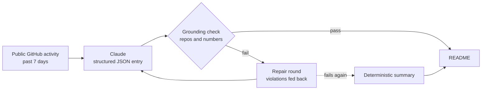

<!-- Generated by scripts/build.py from profile.toml. Edit those, not this file. -->

<picture>
  <source media="(prefers-color-scheme: dark)" srcset="assets/hero-dark.svg">
  
</picture>

<p align="center">
<a href="https://www.linkedin.com/in/math-191231"></a> <a href="mailto:matheshwara13@gmail.com"></a> <a href="https://ieeexplore.ieee.org/document/9569897"></a> <a href="https://github.com/msenthi7/Research-and-Publications/tree/main/Patent"></a> <a href="#7-lab-notebook"></a>
</p>

> **Abstract.** We present *matheshwara-v2026*, a human model pre-trained on electronics and signals (one IEEE paper, one patent) and fine-tuned on machine learning at the University of Maryland. It specialises in **grounded LLM systems**: a clinical-triage assistant built at the Anthropic Hackathon, a stress-testing framework in which Claude reads Fed language to steer a stochastic rate model, and retrieval pipelines that keep patient data on the machine. As a data scientist at the UMD Counseling Center Research Unit, it co-authored a campus-wide study of food access and student well-being and an APA 2026 poster comparing ChatGPT with human researchers. This README is itself an experiment: an LLM agent writes its lab notebook every week, and a grounding check rejects anything it can't trace to real activity.

## 1. Model card

| **Model** | `matheshwara-v2026` |
|:--|:--|
| **Pre-training** | Electronics & signals: an [IEEE UCMMT 2021 paper](https://ieeexplore.ieee.org/document/9569897) on D-band (160 GHz) traveling-wave-tube amplifiers and an [IoT patent](https://github.com/msenthi7/Research-and-Publications/tree/main/Patent) |
| **Fine-tuning** | Machine learning & data science at the University of Maryland |
| **Deployment** | Data Scientist, [UMD Counseling Center Research Unit](https://counseling.umd.edu/about-us/research-unit): campus-wide survey research on food access and student well-being, presented to the Vice President of Student Affairs and at the [Maryland Student Affairs Conference](https://msac.umd.edu/conference-program/sessions) |
| **Specialisation** | Grounded LLM systems: retrieval, tool-using agents, and LLMs as bounded signals inside quantitative models |
| **Intended use** | AI that has to be right: healthcare, finance, safety |
| **Out of scope** | Hallucinated medical advice. [ClinIQ](https://github.com/msenthi7/ClaudeHack) answers only from retrieved context |
| **Eval highlights** | R² 0.918 on EV range · MAD 1.279 on book ratings · 1,000-path Monte Carlo VaR / CVaR |
| **Known limitations** | Overfits to hard problems. Will refactor your notebook into a pipeline. |
| **Status** | Open to ML / AI engineering roles and research collaborations |

## 2. What I attend to

<picture>
  <source media="(prefers-color-scheme: dark)" srcset="assets/attention-dark.svg">
  
</picture>

<sub>Each cell is a row-wise softmax over how many of my projects in that domain use that method, computed by
<code>scripts/build.py</code> from the tags in <code>profile.toml</code>. The dashed box is the query being processed.</sub>

## 3. Experiments

<table>
<tr>
<td width="50%" valign="top">
<code>exp-11</code> <b><a href="https://github.com/msenthi7/ClaudeHack">ClinIQ</a></b> <sub>· Clinical AI</sub><br>
<i>Can a local LLM help an under-resourced clinic triage patients without inventing medical facts?</i><br>
<sub><b>METHOD</b> Transparent rule-based severity score → llama3.1 (Ollama) clinical and plain-language summaries → strict RAG over ChromaDB (Gale Encyclopedia + openFDA labels) → 3-step prescription-safety check</sub><br>
<sub><b>RESULT</b> Built for the Anthropic Hackathon (Health &amp; Wellbeing). Chat answers only from retrieved chunks; AI features disable themselves if the knowledge base is missing</sub><br>
<sub><code>Retrieval / RAG · Local LLMs · Guardrails · Agents / MCP · Data pipelines</code></sub>
</td>
<td width="50%" valign="top">
<code>exp-09</code> <b><a href="https://github.com/msenthi7/Quant_LLM">Sentimental Liquidity</a></b> <sub>· Quant finance</sub><br>
<i>Can central-bank language move a stochastic rate model without letting the LLM become the model?</i><br>
<sub><b>METHOD</b> Claude scores FOMC text for hawkishness (1–10) → bounded multiplier on the Vasicek mean-reversion speed → 1,000 Monte Carlo rate paths → logistic deposit-attrition model on 100k synthetic customers</sub><br>
<sub><b>RESULT</b> Net-interest-margin distribution with 90 / 95 / 99 % VaR and CVaR on a synthetic $10B deposit book</sub><br>
<sub><code>LLM APIs · Stochastic sim · Classical ML · Guardrails</code></sub>
</td>
</tr>
<tr>
<td width="50%" valign="top">
<code>exp-10</code> <b><a href="https://github.com/msenthi7/TravelGenie">TravelGenie</a></b> <sub>· Agentic tools</sub><br>
<i>Can one model coordinate many specialist tools to plan a whole trip from a single request?</i><br>
<sub><b>METHOD</b> Claude orchestrates 7 MCP servers (flights, hotels, events, geocoding, weather, FX, traffic) behind Streamlit and Slack front ends</sub><br>
<sub><b>RESULT</b> One prompt → day-by-day itinerary with a budget breakdown (team project)</sub><br>
<sub><code>Agents / MCP · LLM APIs · Data pipelines</code></sub>
</td>
<td width="50%" valign="top">
<code>exp-06</code> <b><a href="https://github.com/msenthi7/RAG_using_Mistral_ChromaDB">Local Medical RAG</a></b> <sub>· Clinical AI</sub><br>
<i>Can a medical Q&amp;A bot be useful while patient data never leaves the machine?</i><br>
<sub><b>METHOD</b> Ollama + Chroma + HuggingFace embeddings; intent routing for off-topic queries, a retrieval relevance threshold, stateful follow-ups; Dockerised</sub><br>
<sub><b>RESULT</b> Fully local pipeline: no third-party calls for protected health information</sub><br>
<sub><code>Retrieval / RAG · Local LLMs · Guardrails · MLOps / cloud</code></sub>
</td>
</tr>
<tr>
<td width="50%" valign="top">
<code>exp-07</code> <b><a href="https://github.com/msenthi7/Medical-Chatbot-using-LLMs-Langchain-Pinecone-Flask-and-AWS">Medical Chatbot on AWS</a></b> <sub>· Clinical AI</sub><br>
<i>What does it take to run a RAG chatbot in production, not just in a notebook?</i><br>
<sub><b>METHOD</b> LangChain + Pinecone + GPT behind Flask; Docker image built by GitHub Actions, pushed to ECR and deployed to EC2</sub><br>
<sub><b>RESULT</b> Commit-to-container CI/CD path with conversation memory and LangSmith monitoring hooks</sub><br>
<sub><code>Retrieval / RAG · LLM APIs · MLOps / cloud</code></sub>
</td>
<td width="50%" valign="top">
<code>exp-08</code> <b><a href="https://github.com/msenthi7/Predicting-EV-Trends-and-Charging-Needs">Watt&#x27;s Next?</a></b> <sub>· Applied ML</sub><br>
<i>How far will the next EV go, and where should the chargers go?</i><br>
<sub><b>METHOD</b> 216,772 Washington-state EV records: range regression, SMOTE-balanced incentive classification, clustering and geospatial analysis (co-authored)</sub><br>
<sub><b>RESULT</b> R² = 0.918 on electric-range prediction</sub><br>
<sub><code>Classical ML · Data pipelines</code></sub>
</td>
</tr>
<tr>
<td width="50%" valign="top">
<code>exp-04</code> <b><a href="https://github.com/msenthi7/Item-Item-Collaborative-Filterning">Item-Item Collaborative Filtering</a></b> <sub>· Applied ML</sub><br>
<i>How many neighbours does a book recommender actually need?</i><br>
<sub><b>METHOD</b> Cosine-similarity KNN on a sparse item × user matrix, sweeping neighbourhood size and training ratio, global-mean cold-start fallback</sub><br>
<sub><b>RESULT</b> Best MAD 1.279 at k = 15; ratio sweep peaks at 0.85</sub><br>
<sub><code>Classical ML</code></sub>
</td>
<td width="50%" valign="top">
<code>exp-12</code> <b><a href="https://github.com/msenthi7/msenthi7">This profile</a></b> <sub>· Agentic tools</sub><br>
<i>Can an LLM agent keep this README current without hallucinating?</i><br>
<sub><b>METHOD</b> Weekly GitHub Action: public activity → Claude (structured JSON) → grounding check on every repo name and number → one repair round → deterministic fallback</sub><br>
<sub><b>RESULT</b> Every published entry is traceable to the week&#x27;s activity; figures are rendered from this repo&#x27;s profile.toml</sub><br>
<sub><code>LLM APIs · Agents / MCP · Guardrails · MLOps / cloud</code></sub>
</td>
</tr>
</table>

<details>
<summary><b>4 more runs</b> (data engineering, statistics, scrapers)</summary>

- `exp-05` [Bitcoin streaming](https://github.com/msenthi7/BITCOIN_ANALYSIS_USING_STREAMZ): Reactive price ingestion with Streamz; CoinGecko primary, CryptoCompare fallback, exponential backoff
- `exp-03` [Life-expectancy modelling](https://github.com/msenthi7/LifeExpectancy-Analysis): Interaction-term regression on Gapminder with an F-test and residual diagnostics
- `exp-02` [Solar Flare Reporter](https://github.com/msenthi7/Solar-Flare-Reporter): Selenium scraper and analysis of NASA's top-50 solar flares
- `exp-01` [Webpdf Scraper](https://github.com/msenthi7/Webpdf-Scraper): Crawls a site and extracts every linked PDF and PPT document

</details>

## 4. Inductive biases

The priors I bring to every AI system, each with the repo where it's applied.

| Prior | In practice | Evidence |
|:--|:--|:--|
| **Ground, then generate** | Retrieve first and answer only from what was retrieved. ClinIQ's system prompt forbids outside knowledge for medical answers. | [`ClaudeHack`](https://github.com/msenthi7/ClaudeHack) |
| **The LLM is a sensor, not the model** | Claude returns one bounded score from Fed language; it shifts the Vasicek mean-reversion speed by −40 % to +50 %, and the SDE, Monte Carlo and VaR stay deterministic and auditable. | [`Quant_LLM`](https://github.com/msenthi7/Quant_LLM) |
| **Deterministic core, generative surface** | Patients are ranked by a transparent point-based severity score; the LLM writes the summaries, never the ranking. | [`ClaudeHack`](https://github.com/msenthi7/ClaudeHack) |
| **Fail closed** | Every structured LLM call is parsed with fallback defaults; this profile's agent retries once, then falls back to a summary it can't get wrong. | [`msenthi7`](https://github.com/msenthi7/msenthi7) |
| **Sensitive data stays local** | Medical Q&A runs on Ollama + Chroma on the machine, so protected health information never reaches a third party. | [`RAG_using_Mistral_ChromaDB`](https://github.com/msenthi7/RAG_using_Mistral_ChromaDB) |
| **Specialists over a monolith** | One orchestrating model, seven MCP servers, each owning exactly one job. | [`TravelGenie`](https://github.com/msenthi7/TravelGenie) |

## 5. Training run

<picture>
  <source media="(prefers-color-scheme: dark)" srcset="assets/training-dark.svg">
  
</picture>

<sub>Loss spikes at each distribution shift (a new field) and recovers faster every time. The curve is illustrative;
the checkpoints are real.</sub>

## 6. Research, publications & talks

- **Paper** · [Preliminary Analysis of a Folded Waveguide Slow-Wave Structure for 160GHz Traveling Wave Tube Amplifier](https://ieeexplore.ieee.org/document/9569897)  
  Surya Prasath C, Ipsit Ray, J Sneka, **A.S. Matheshwara**, Richards Joe Stanislaus · 2021 14th UK-Europe-China Workshop on Millimetre-Waves and Terahertz Technologies (UCMMT), Lancaster, UK, pp. 1–3 · DOI [10.1109/UCMMT53364.2021.9569897](https://doi.org/10.1109/UCMMT53364.2021.9569897)  
  <sub>Dispersion analysis of a D-band folded-waveguide slow-wave structure: a 20 GHz operating band (155–175 GHz) at an RF phase velocity of 0.244c, for 5G backhaul and inter-satellite links.</sub>
- **Poster** · *A study of artificial intelligence usage by ChatGPT and human researchers*  
  Wang, Y.-W., Wachowski, C., **Annamalai Senthilkumar, M.**, Mellacheruvu, M., & Maki, A. · American Psychological Association Annual Meeting, Washington, DC, August 2026
- **Report** · *The University of Maryland Food Access & Student Well-being Study: 2025 campus survey*  
  Wang, Y.-W., Wachowski, C., **Annamalai Senthilkumar, M.**, Kurz, A., & Maki, A. · University of Maryland Counseling Center Research Unit, 2026  
  <sub>Campus-wide survey of food access and student well-being; findings presented to UMD leadership and student government (see presentations below).</sub>
- **Workshop** · [Working together to build resilient programming to support financially vulnerable students](https://msac.umd.edu/conference-program/sessions)  
  Wang, Y.-W., Bello, J. M., Watkins, B., Wachowski, C., & **Annamalai Senthilkumar, M.** · Maryland Student Affairs Conference, University of Maryland, College Park, February 2026
- **Patent** · [Smart Wearable Device for Toddlers](https://github.com/msenthi7/Research-and-Publications/tree/main/Patent)  
  **Matheshwara**, Yogeshwar G · Patent No. 202241031906  
  <sub>Flex-sensor / Velostat wearable that detects abnormal physical contact and alerts guardians in real time through a Blynk cloud app.</sub>

**Presentations** <sub>Wang, Y.-W., Wachowski, C., **Annamalai Senthilkumar, M.**, Kurz, A., & Maki, A.</sub>

- **Apr 2026** · *Interconnected factors shaping student success and well-being: What the data tell us* · UMD Counseling Center Research & Development Speaker Series
- **Apr 2026** · *Interconnected factors shaping student success and well-being: What the data tell us* · BEACON (Building Early Alerts for Campus Outreach Needs) team, UMD
- **Apr 2026** · *The University of Maryland Food Access & Student Well-being Study: 2025 campus survey* · UMD Graduate Student Government General Assembly
- **Mar 2026** · *The University of Maryland Food Access & Student Well-being Study: 2025 campus survey* · UMD Vice President of Student Affairs & Council

<details>
<summary><b>BibTeX</b></summary>

```bibtex
@inproceedings{prasath2021fwg,
  author    = {{Surya Prasath C} and Ipsit Ray and J. Sneka and A. S. Matheshwara and Richards Joe Stanislaus},
  title     = {Preliminary Analysis of a Folded Waveguide Slow-Wave Structure for 160GHz Traveling Wave Tube Amplifier},
  booktitle = {2021 14th UK-Europe-China Workshop on Millimetre-Waves and Terahertz Technologies (UCMMT)},
  address   = {Lancaster, United Kingdom},
  year      = {2021},
  pages     = {1--3},
  doi       = {10.1109/UCMMT53364.2021.9569897}
}
```

</details>

## 7. Lab notebook

Every Monday a GitHub Action reads my public activity and has Claude write this entry. It is only published if every
repository and number in it can be traced back to that activity.

_No entries yet. The agent writes one each Monday after a week with public activity._

<details>
<summary><b>How the agent works</b></summary>



- **Grounded by construction.** The model only sees the week's activity as JSON, and returns `headline`, `body` and
  `repos` through structured output.
- **Checked, not trusted.** [`scripts/lab_notebook.py`](scripts/lab_notebook.py) rejects any repo that wasn't touched
  that week, any number not in the data, and any link. Violations are fed back for one repair round.
- **Fails closed.** If the repair also fails, or there's no API key, a deterministic summary is published instead. A week
  with no activity gets no entry.
- **Tested.** [`tests/`](tests) runs on every build.

</details>

---

<sub>Figures are SVGs generated by <a href="scripts/build.py"><code>scripts/build.py</code></a> from
<a href="profile.toml"><code>profile.toml</code></a>: no third-party stats services. Refreshed weekly by
<a href=".github/workflows/refresh.yml">GitHub Actions</a>.</sub>
